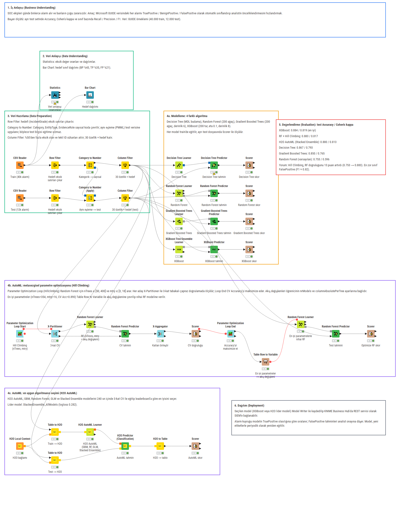

# Güvenlik Alarmı Sınıflandırma (Microsoft GUIDE)

Bir SOC'a gelen güvenlik alarmlarını **TruePositive** (gerçek saldırı), **BenignPositive** (gerçek ama zararsız aktivite) ve **FalsePositive** (yanlış alarm) olarak sınıflandıran çok sınıflı bir model. Problem önce **KNIME** ile, sonra **Python** ile, her ikisinde de **CRISP-DM** adımlarıyla çözüldü. Her iki tarafta birden fazla model ve iki tür AutoML (metasezgisel parametre optimizasyonu + en iyi algoritma seçimi) kullanıldı.



## Sonuçlar (ayrı test seti, 12.000 alarm)

### KNIME

| Model | Accuracy | Cohen's kappa |
|---|---|---|
| **XGBoost** | **0.884** | **0.819** |
| RF + Hill Climbing (nTrees=354, mtry=16) | 0.883 | 0.817 |
| H2O AutoML (Stacked Ensemble) | 0.880 | 0.813 |
| Decision Tree | 0.867 | 0.793 |
| Gradient Boosted Trees | 0.850 | 0.765 |
| Random Forest (varsayılan) | 0.753 | 0.596 |

Hill Climbing, Random Forest doğruluğunu 0.753'ten 0.883'e çıkardı.

### Python

| Model | Accuracy | Macro F1 | TruePositive Recall |
|---|---|---|---|
| **AutoML (GA ile seçilen LightGBM)** | **0.878** | **0.868** | **0.883** |
| XGBoost (varsayılan) | 0.875 | 0.865 | 0.882 |

5-kat CV Macro F1 karşılaştırması: XGBoost 0.887, LightGBM 0.880, Decision Tree 0.864, Random Forest 0.835, Extra Trees 0.779, Logistic Regression 0.515.

## AutoML

| | KNIME | Python |
|---|---|---|
| Metasezgisel parametre optimizasyonu | Parameter Optimization Loop, **Hill Climbing**, 3-kat tabakalı CV | Optuna **NSGA-II** (genetik algoritma), 40 deneme |
| En uygun algoritma seçimi | **H2O AutoML**: GBM, RF, GLM, Stacked Ensemble | GA arama uzayında algoritma da bir gen: RF, Extra Trees, XGBoost, LightGBM |

## Klasör yapısı

```
knime/       KNIME_Siniflandirma_GUIDE.knwf, iş akışı görseli (png/svg)
notebooks/   01_incident_classification.ipynb (çalıştırılmış, çıktılarıyla)
docs/        KNIME_Raporu.md, Python_Raporu.md, figures/
data/        40.000 / 12.000 satırlık örneklem ve kaynak bilgisi
results/     KNIME sonuç tabloları (JSON)
models/      Python AutoML modeli (joblib)
```

## Çalıştırma

**KNIME:** KNIME Analytics Platform 5.x → File → Import KNIME Workflow → `knime/KNIME_Siniflandirma_GUIDE.knwf`. Veri iş akışının içinde. Gerekli eklentiler: *KNIME XGBoost Integration*, *KNIME H2O Machine Learning Integration*.

**Python:**
```bash
pip install -r requirements.txt
jupyter notebook notebooks/01_incident_classification.ipynb
```

## Raporlar

- [KNIME raporu](docs/KNIME_Raporu.md)
- [Python raporu](docs/Python_Raporu.md)

Veri: [Microsoft Security Incident Prediction (GUIDE), Kaggle](https://www.kaggle.com/datasets/Microsoft/microsoft-security-incident-prediction)
