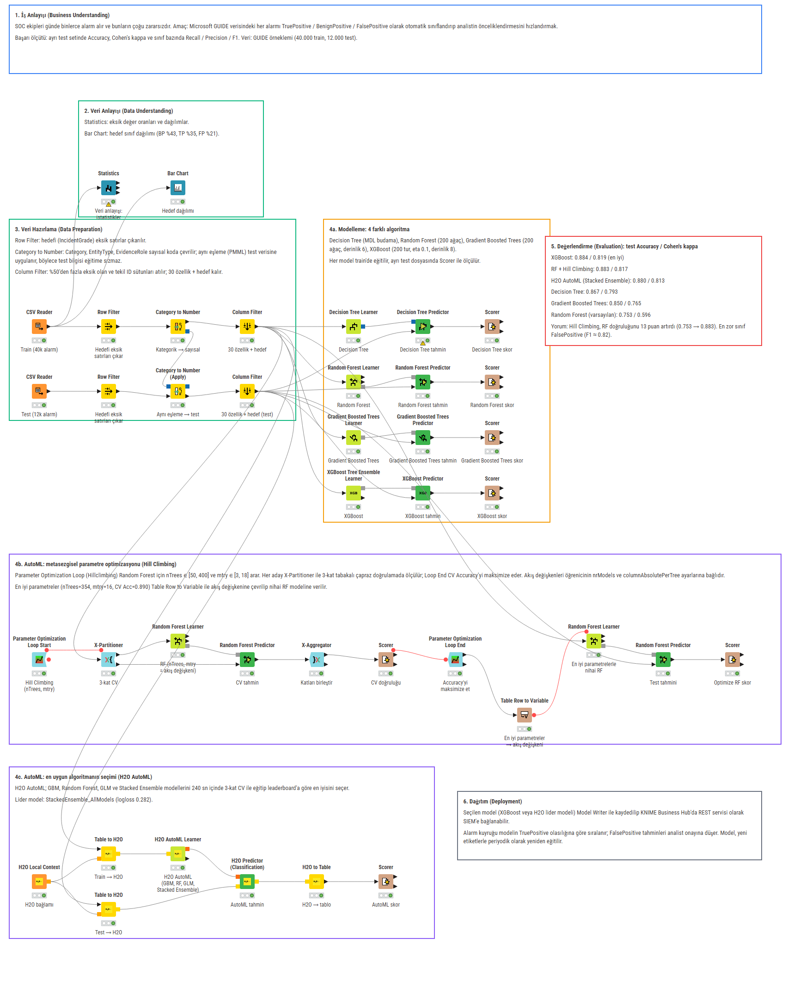

# KNIME Raporu: Güvenlik Alarmı Sınıflandırma (Microsoft GUIDE)

İş akışı: `knime/KNIME_Siniflandirma_GUIDE.knwf` (KNIME Analytics Platform 5.x)



İş akışı CRISP-DM aşamalarına göre renkli kutulara ayrılmıştır. Her kutunun içinde o aşamanın açıklaması yazılıdır.

## 1. İş Anlayışı

SOC ekipleri günde binlerce alarm alır ve bunların çoğu zararsızdır. Amaç, Microsoft GUIDE verisindeki her alarmı **TruePositive / BenignPositive / FalsePositive** olarak sınıflandırıp analistin önceliklendirmesini hızlandırmak. Başarı ölçütü: ayrı test setinde Accuracy, Cohen's kappa ve sınıf bazında Recall / Precision / F1.

## 2. Veri Anlayışı

| Düğüm | Görev |
|---|---|
| CSV Reader (×2) | Eğitim 40.000, test 12.000 alarm |
| Statistics | Sütun bazında eksik oranları ve dağılımlar. 10 sütun %50'den fazla eksik |
| Bar Chart | Hedef dağılımı: BenignPositive %43, TruePositive %35, FalsePositive %21 |

## 3. Veri Hazırlama

| Düğüm | Görev |
|---|---|
| Row Filter (×2) | Hedefi (IncidentGrade) eksik satırlar çıkarılır |
| Category to Number | Category, EntityType, EvidenceRole sayısal koda çevrilir. Eşleme PMML olarak çıkar |
| Category to Number (Apply) | Aynı eşleme test verisine uygulanır: test bilgisi eğitime sızmaz |
| Column Filter (×2) | %50'den fazla eksik ve tekil ID sütunları atılır; 30 özellik + hedef kalır |

## 4a. Modelleme: 4 algoritma

Her model eğitim verisinde eğitilir, ayrı test dosyasına uygulanır, Scorer ile ölçülür.

| Model | Ayarlar |
|---|---|
| Decision Tree | MDL budama |
| Random Forest | 200 ağaç (varsayılan sütun örnekleme) |
| Gradient Boosted Trees | 200 ağaç, derinlik 6 |
| XGBoost Tree Ensemble | 200 tur, eta 0.1, derinlik 8 |

## 4b. AutoML: metasezgisel parametre optimizasyonu (Hill Climbing)

```
Parameter Optimization Loop Start (Hillclimbing)
  → X-Partitioner (3 kat, tabakalı) → RF Learner → RF Predictor → X-Aggregator → Scorer
→ Parameter Optimization Loop End (CV Accuracy'yi maksimize et)
→ Table Row to Variable → Nihai RF Learner (tüm eğitim verisi) → Predictor → Scorer (test)
```

- Arama uzayı: `nTrees` 50-400, `mtry` (ağaç başına sütun sayısı) 3-18.
- Akış değişkenleri RF öğrenicisinin `nrModels` ve `columnAbsolutePerTree` ayarlarına bağlıdır; sütun örnekleme modu "Absolute".
- Hill Climbing her adımda komşu kombinasyonları dener, CV doğruluğunu artıran yöne ilerler ve iyileşme kalmayınca durur.
- Denenen kombinasyonlar ve CV doğruluğu:

| nTrees | mtry | CV Accuracy |
|---|---|---|
| 254 | 13 | 0.852 |
| 354 | 13 | 0.857 |
| 304 | 10 | 0.840 |
| 304 | 13 | 0.857 |
| 304 | 16 | 0.889 |
| 254 | 16 | 0.886 |
| **354** | **16** | **0.890** |

mtry'yi artırmak (her bölünmede daha fazla aday özellik) doğruluğu belirgin artırdı; ağaç sayısının etkisi küçük.

## 4c. AutoML: en uygun algoritmanın seçimi (H2O AutoML)

```
H2O Local Context → Table to H2O (eğitim / test) → H2O AutoML Learner → H2O Predictor (Classification) → H2O to Table → Scorer
```

H2O AutoML; GBM, Distributed Random Forest, GLM ve Stacked Ensemble modellerini 240 saniye içinde 3-kat CV ile eğitip leaderboard'a göre en iyisini seçer. Lider: **StackedEnsemble_AllModels** (CV logloss 0.282, ortalama sınıf hatası 0.125).

## 5. Değerlendirme (ayrı test seti, 12.000 alarm)

| Model | Accuracy | Cohen's kappa |
|---|---|---|
| **XGBoost** | **0.884** | **0.819** |
| RF + Hill Climbing | 0.883 | 0.817 |
| H2O AutoML (Stacked Ensemble) | 0.880 | 0.813 |
| Decision Tree | 0.867 | 0.793 |
| Gradient Boosted Trees | 0.850 | 0.765 |
| Random Forest (varsayılan) | 0.753 | 0.596 |

- Hill Climbing, Random Forest'ın doğruluğunu **0.753'ten 0.883'e** (13 puan) çıkardı ve onu XGBoost ile aynı seviyeye getirdi.
- En zor sınıf FalsePositive (F1 ≈ 0.82); hatalar çoğunlukla FalsePositive ile BenignPositive arasında.
- Python tarafındaki en iyi model (GA ile seçilen LightGBM) 0.878 doğruluk verdi: iki araç tutarlı.

## 6. Dağıtım

Seçilen model (XGBoost, optimize RF veya H2O lider modeli) Model Writer ile kaydedilip KNIME Business Hub'da REST servisi olarak SIEM'e bağlanabilir. Alarm kuyruğu TruePositive olasılığına göre sıralanır; FalsePositive tahminleri analist onayına düşer. Model yeni etiketlerle periyodik olarak yeniden eğitilir.
