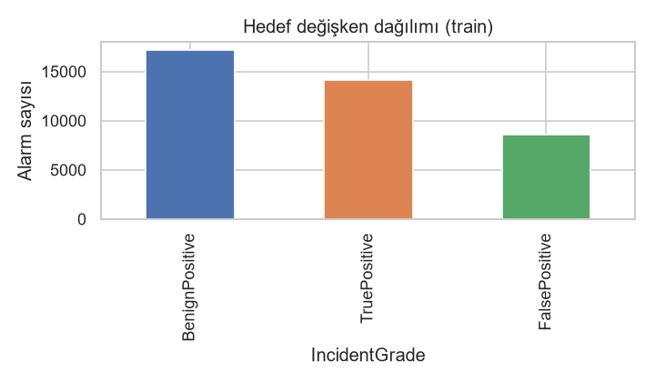
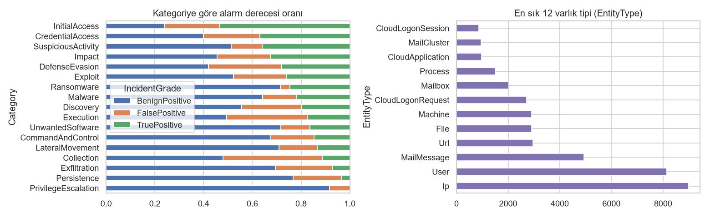
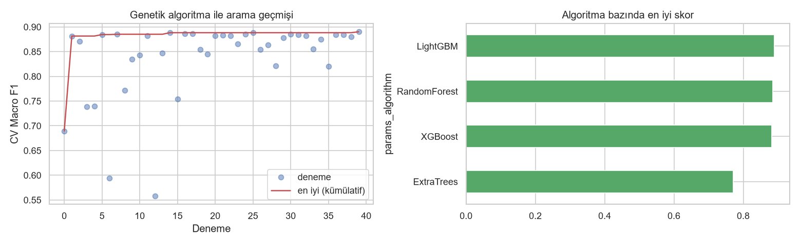
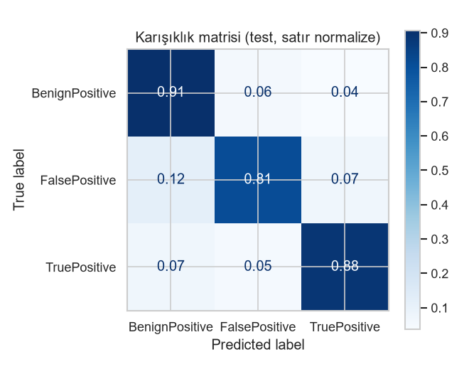
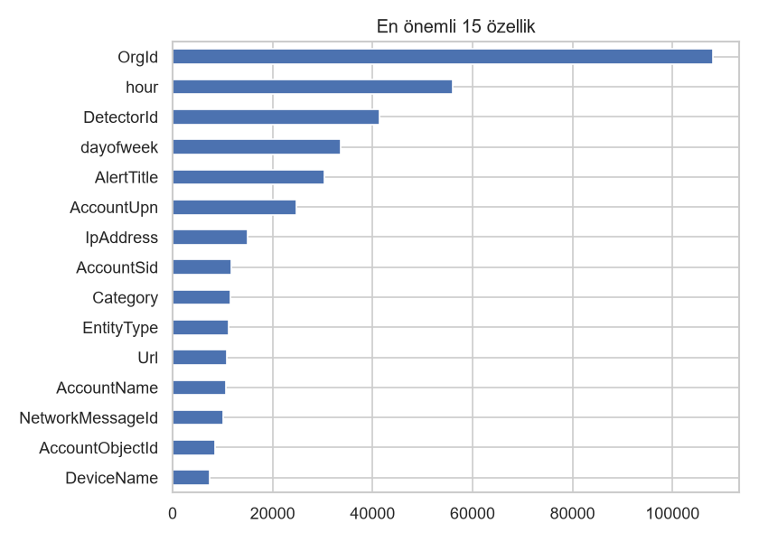

# Python Raporu: Güvenlik Alarmı Sınıflandırma (Microsoft GUIDE)

Notebook: [`notebooks/01_incident_classification.ipynb`](../notebooks/01_incident_classification.ipynb) (çalıştırılmış, tüm çıktılarıyla)

Kütüphaneler: pandas, scikit-learn, XGBoost, LightGBM, Optuna, matplotlib, seaborn.

## 1. İş Anlayışı

SOC analistleri her gün binlerce alarm görür ve çoğu zararsızdır (*alert fatigue*). Amaç, her alarmın derecesini (TruePositive / BenignPositive / FalsePositive) tahmin edip önceliklendirmeyi otomatikleştirmek.

- Ana metrik **Macro F1**: sınıflar dengesiz, her sınıfa eşit ağırlık verilmeli.
- İş açısından en pahalı hata gerçek saldırıyı kaçırmak. Bu yüzden **TruePositive recall** ayrıca izlenir.

## 2. Veri Anlayışı

- Microsoft GUIDE veri setinden 40.000 eğitim ve 12.000 test satırlık rastgele örnek, 45 sütun.
- Hedef dağılımı: BenignPositive 17.135, TruePositive 14.122, FalsePositive 8.533, 210 satırda etiket yok.
- 10 sütunda eksik oranı %50'nin üzerinde (ResourceType %99.9, ActionGrouped %99.4, ..., MitreTechniques %57.6).

## 3. Veri Hazırlama

- Etiketi olmayan 210 satır atıldı.
- %50'den fazla eksik sütunlar ve satır kimlikleri (Id, IncidentId, AlertId, Timestamp) çıkarıldı. 33 özellik kaldı.
- Metin tipindeki 3 sütun (Category, EntityType, EvidenceRole) eğitim setinden öğrenilen eşlemeyle sayıya çevrildi; testte görülmeyen değerler -1.
- Diğer ID sütunları (DeviceId, Sha256, IpAddress...) Microsoft tarafından zaten sayısallaştırılmış kategoriler; ağaç modelleri bunları doğrudan kullanır.

## 4. Modelleme

### 4.1 Model karşılaştırması (5-kat tabakalı CV)

| Model | CV Macro F1 | Std |
|---|---|---|
| XGBoost | 0.887 | 0.005 |
| LightGBM | 0.880 | 0.003 |
| Decision Tree | 0.864 | 0.004 |
| Random Forest | 0.835 | 0.003 |
| Extra Trees | 0.779 | 0.002 |
| Logistic Regression | 0.515 | 0.004 |

Ağaç tabanlı modeller açık ara önde. Lojistik regresyonun düşük skoru, ID benzeri sütunlar ile sınıf arasındaki ilişkinin doğrusal olmadığını gösteriyor.

### 4.2 AutoML: genetik algoritma (NSGA-II) ile algoritma + hiperparametre seçimi

- Optuna `NSGAIISampler`: popülasyon 10, mutasyon olasılığı 0.2, çaprazlama 0.9, 40 deneme.
- Algoritma da genin bir parçası: Random Forest, Extra Trees, XGBoost, LightGBM. Her birinin kendi hiperparametreleri aranır.
- Amaç fonksiyonu: 3-kat tabakalı CV Macro F1 (maksimize).
- Sonuç: **LightGBM**, 600 ağaç, 235 yaprak, öğrenme oranı 0.054; CV Macro F1 **0.890**.

## 5. Değerlendirme (ayrı test seti, 12.000 alarm)

| Model | Accuracy | Macro F1 | TP Recall |
|---|---|---|---|
| Varsayılan XGBoost | 0.875 | 0.865 | 0.882 |
| **AutoML: LightGBM** | **0.878** | **0.868** | **0.883** |

Sınıf bazında (AutoML modeli):

| Sınıf | Precision | Recall | F1 |
|---|---|---|---|
| BenignPositive | 0.886 | 0.907 | 0.896 |
| FalsePositive | 0.811 | 0.812 | 0.811 |
| TruePositive | 0.910 | 0.883 | 0.896 |

En zor sınıf FalsePositive: bunların %12'si BenignPositive olarak tahmin ediliyor. Gerçek saldırıların yalnızca %5'i yanlış alarm (FalsePositive) olarak etiketleniyor, %7'si BenignPositive'e kayıyor.

## 6. Dağıtım

Model ve ön işleme eşlemeleri tek bir dosyada saklanır (`models/incident_classifier.joblib`). Yeni bir alarm tablosu aynı `prepare` adımlarından geçirilip tahmin edilir; notebook'un sonunda bunun örneği var.

## 7. Sonuç ve kısıtlar

- 6 algoritma karşılaştırıldı, gradient boosting ailesi en iyisi oldu. GA tabanlı AutoML test setinde varsayılan XGBoost'u bir miktar geçti.
- KNIME tarafında da XGBoost (0.884) ve H2O AutoML (0.880) en iyi iki model oldu: iki araç tutarlı.
- Örneklem orijinal verinin yaklaşık %0.4'ü; tam veriyle skorlar artacaktır. Alarmlar olay (incident) bazında gruplanmadan örneklendi.
- Sonraki adımlar: olay düzeyinde toplulaştırılmış özellikler (olay başına alarm sayısı, farklı varlık sayısı), maliyet duyarlı karar eşiği.
